# smine

smine is a component system for Claude Code: sixteen installable pieces, each a settings fragment, a hook, daemon or standalone binary, or a file tree, installed into the agent's own configuration by one installer that knows what every piece requires and what degrades without it. The skills also render for Codex. The docs live at [smine.info](https://smine.info).

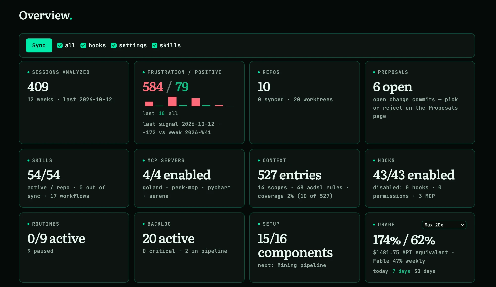

Each component grew out of pure necessity while working with modern agents and solves one particular problem:

## Endless Permission Prompts

Behind every tool call sits the Never Prompter, a transparent multi-layered filter enclosing Claude Code's permission modes except bypass, so what may run is declared once, per settings, skill and plan. Prompts are eliminated entirely.

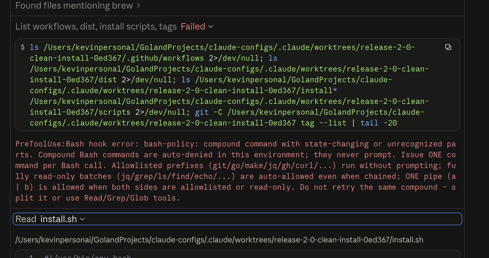

[smine.info/permissions.html](https://smine.info/permissions.html)

## Untraceable Hallucinations

ACDSL, the Agentic Context Domain Specific Linter, turns context into something a linter can check: every rule that can be verified is, and prose becomes a lintable rule wherever possible. Hallucinations for linted context are eliminated, which improves the reliability in an explored space. Every rule carries its red rate, how often a session broke it while it sat in context, so a rule is sharpened, turned into a gate or fired on evidence rather than faith.

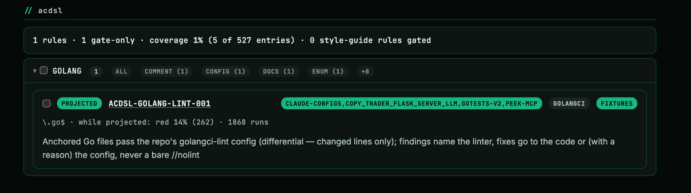

[smine.info/acdsl.html](https://smine.info/acdsl.html)

## Context Roulette

Which instructions an agent has in front of it, and whether it read them at all, used to be uncontrollable and untraceable; the Context Injection System makes it mechanical:

- **Read gate**: Every read, edit and command on a governed file is denied until the file that governs it has been read in full.

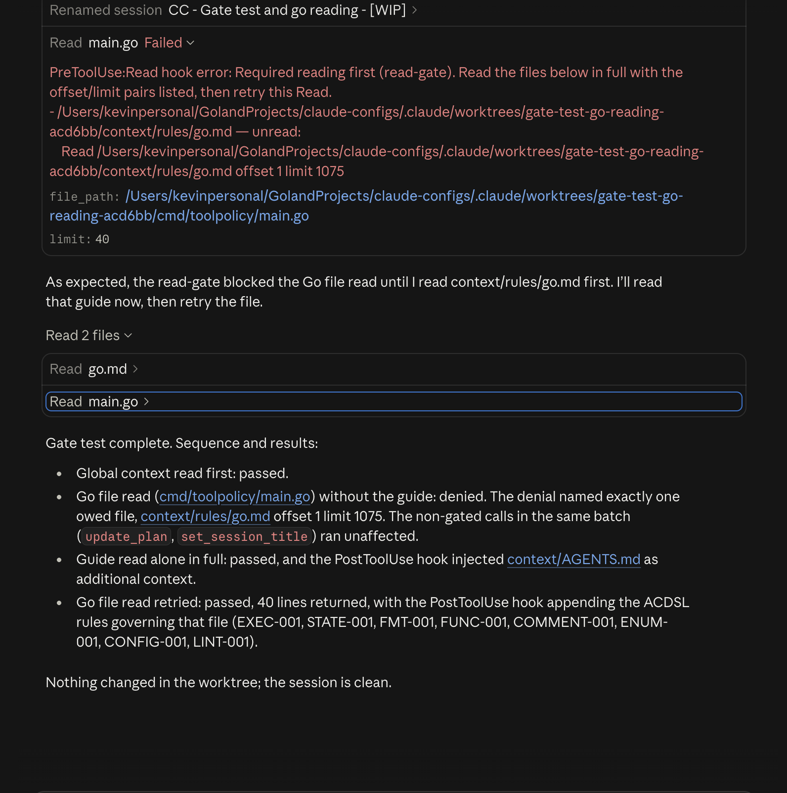

- **Injection**: The declared context arrives as additionalContext at session start, at skill invocation and again after every compaction.

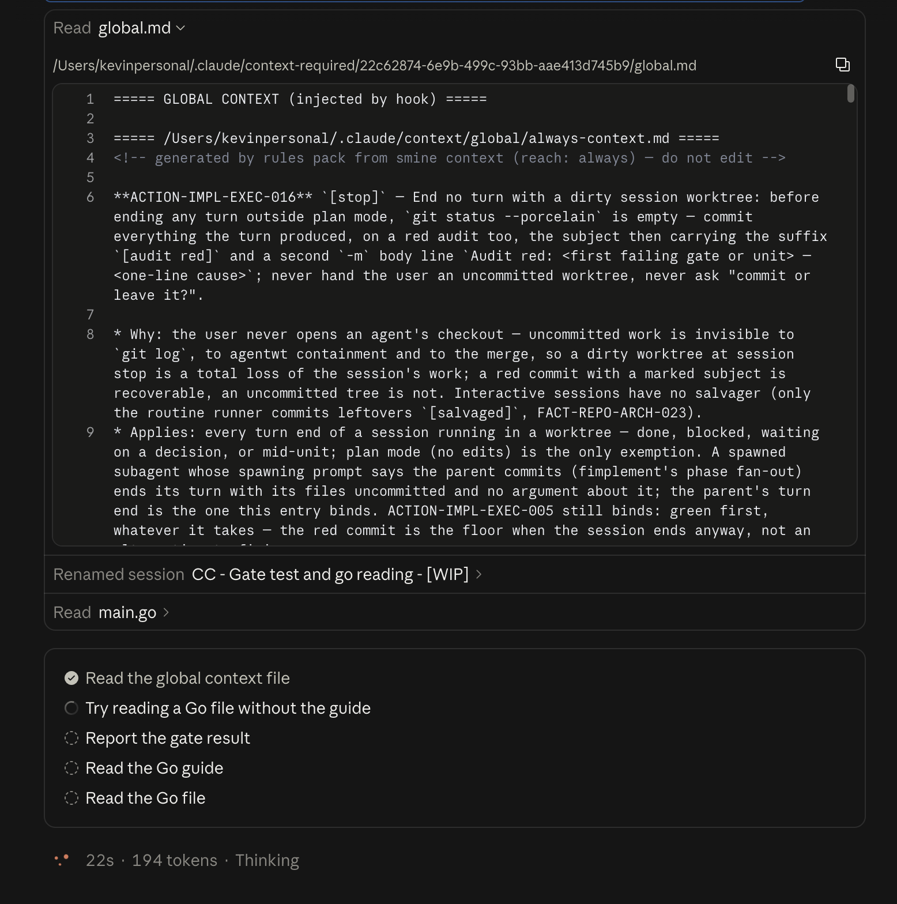

- **Skill context**: A skill declares the entries it needs; their bodies arrive once per agent, their ids on every later invocation.
- And much more: [smine.info/context-system.html](https://smine.info/context-system.html).

Unread and misplaced context are eliminated for everything declared, which is what gives the red rates above their meaning.

[smine.info/context-system.html](https://smine.info/context-system.html)

## Broken, Unscalable, Undynamic Skills

Skills are treated with the same care as any other software that needs to survive in a realistic environment.

A typed model, `<leaf>.cue`, replaces markdown prose; around it sit a schema, cross-reference checks on every load, formal clauses a solver can reason about, runtime anchors a daemon can check, and three test layers. That gives skills back what code always had, and for a reason:

- verifiability
- introspection
- evaluation
- testability
- A/B tests
- a regression guard
- test-driven development

In practice:

- **Model**: Each skill is one typed model, `<leaf>.cue`; its SKILL.md is rendered from it and never edited by hand.

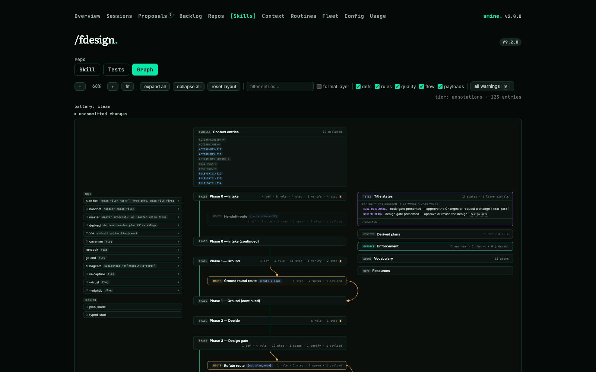

- **Checks**: A schema fixes the shape, every cross-reference is resolved on load, and pipeline edges must agree across skills, so a wrong role, a route to nowhere or an undeclared tool does not render. `pred` and `post` on entries derive a model that Z3 answers questions over, each answer with the entry that proves it; the review skill ships with these, among others:
  - Can a review on a red base ever end in APPROVE? Never.
  - Can a nightly run ever reach the human gate? Never.
  - Can the fix stage run without a review before it? Never.
- **Enforce**: The anchors the heartbeat checks at runtime read the same atoms, so the proof and the check never drift apart.
- **Tests**: Three layers, each with its own price:
  - smoke: one cheap run on a dummy input, checked against the skill's own anchors; every skill declares one
  - eval: one declared configuration measured on time, tokens, cost, step misses and scores; golden runs are the regression guard
  - A/B: one changed factor, model, effort, MCP server, overlay patch or version, against the baseline under a blind judge

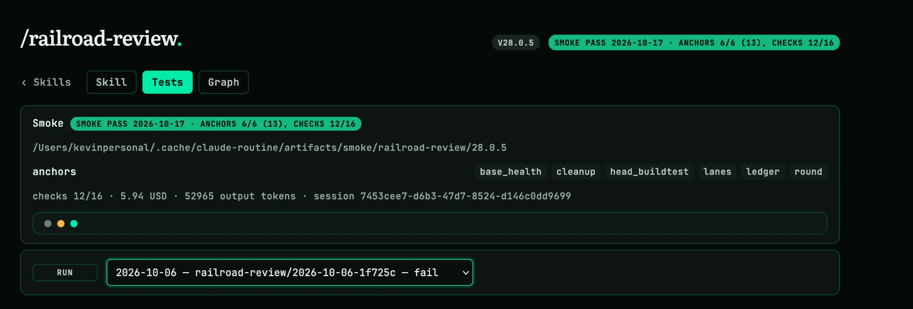

- **Args and routes**: One skill fits every situation it belongs in, and `--help` on any skill is answered from the model by a hook, never by a model call.

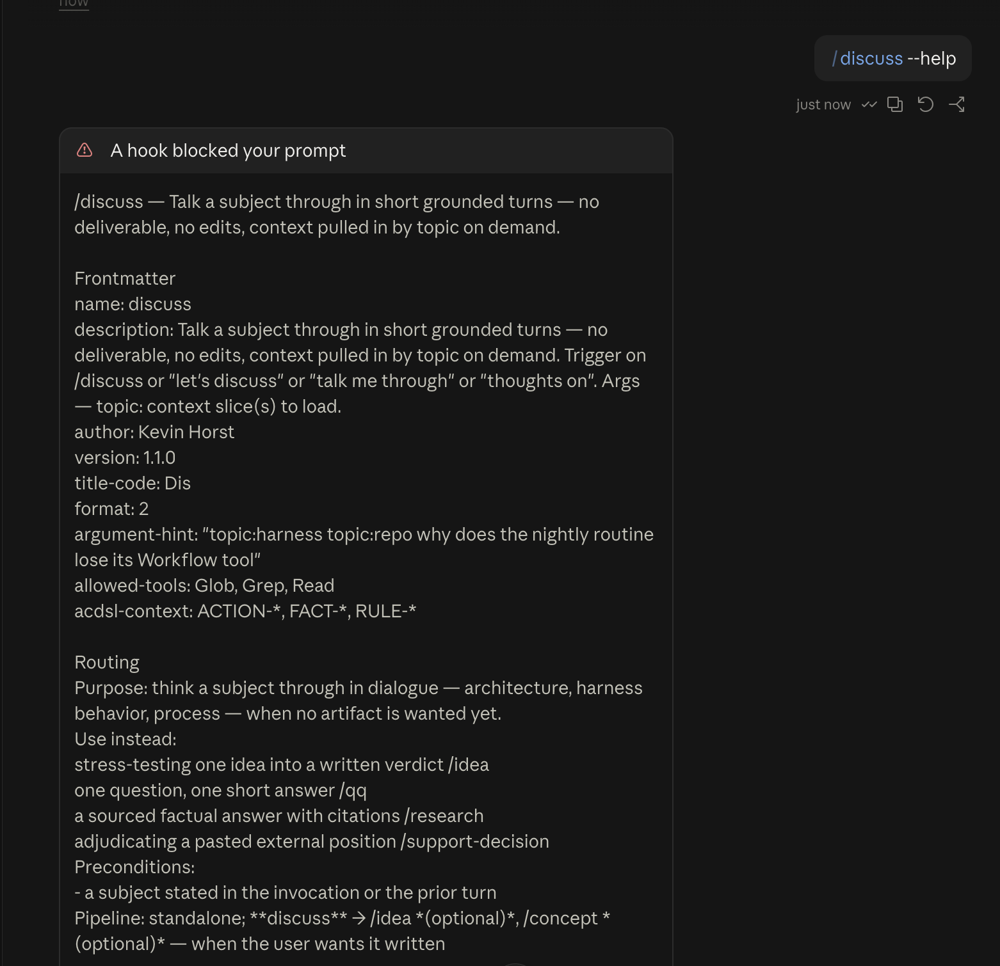

- **Env**: Every program a skill calls is a declared variable, filled per repo at deploy or at invocation.

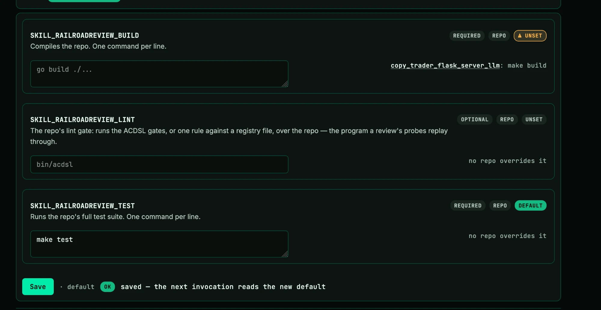

- **Versions**: The changelog lives in the model, and a merge driver keeps both branches' bumps.

Untested change is eliminated for every skill in the model, which makes a skill change as safe as a code change.

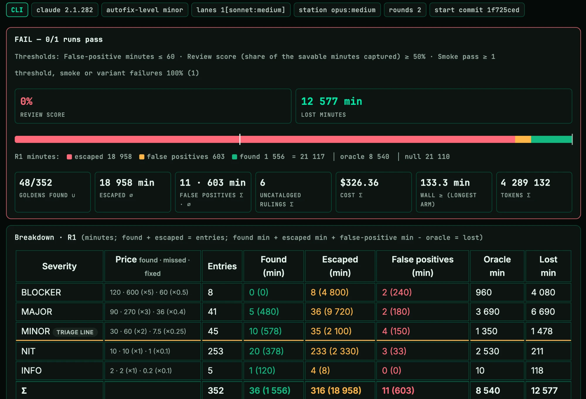

[smine.info/skillcue.html](https://smine.info/skillcue.html) · [smine.info/skill-test-layers.html](https://smine.info/skill-test-layers.html)

## No Runtime Authority

Whether a running session still does what you expect it to as per the loaded skill protocol, and what thirty of them are doing at once, used to be unobservable and unenforceable; the Heartbeat, one Rust daemon under every session, brings it to the surface:

- **Runtime checks**: A skill's contract is checked call by call; a violation is denied with the way back, and repetition ends the run, the so called *heart attack*. The rules live in the heartbeat's config and are enforced wherever cheapest: at the gate before a forbidden call starts, or by the daemon killing the process when it is already running.

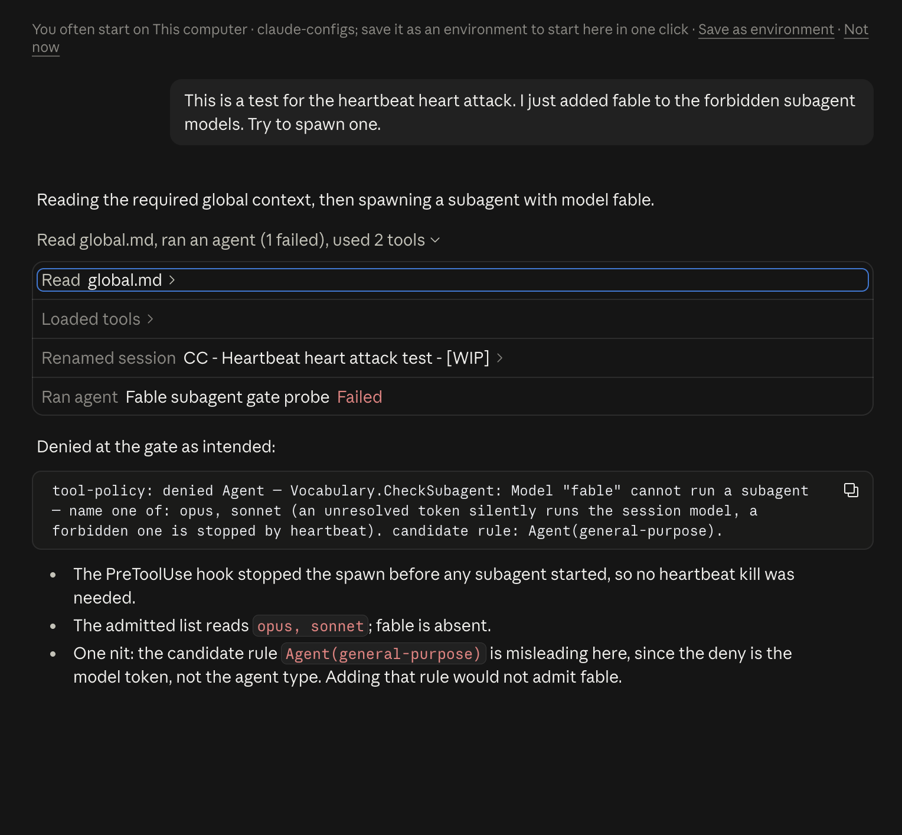

- **Fleet state**: The daemon knows who joined, which letter they hold and who delivered, lands delivered members by fast-forward, and the session title carries the state.
- **Session overview**: Every live session, its skill and its state sit on one page.

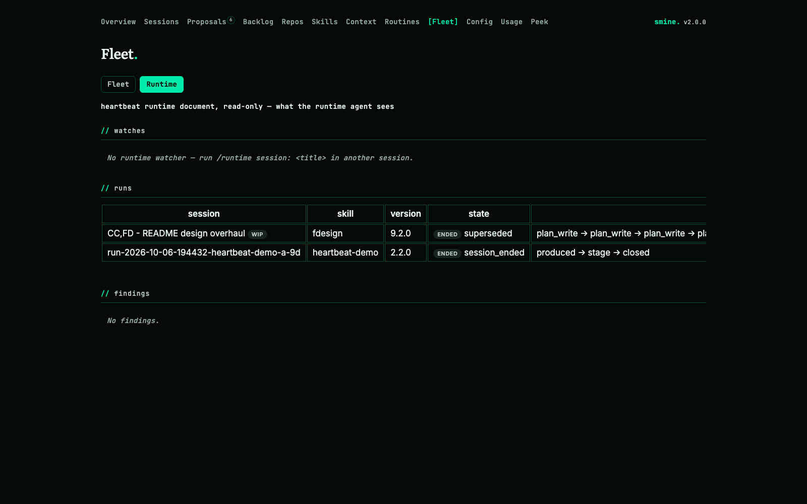

- **The glue**: It is what the rest of smine hangs on, and the part that is still experimental.

Unwatched drift is eliminated for every session under a contract, which is what makes unattended runs accountable.

[smine.info/heartbeat.html](https://smine.info/heartbeat.html)

## Flying Blind

Whether one more run still fits the usage window, and what a session is doing and costing right now, used to be guesswork and hindsight; [Peek](https://github.com/kevinhorst/peek-mcp), with support of [ccusage](https://github.com/ryoppippi/ccusage), makes it predictable:

- **Peek**: Any session's turns, plan, diff and status are read from its transcript, Claude Code or Codex.

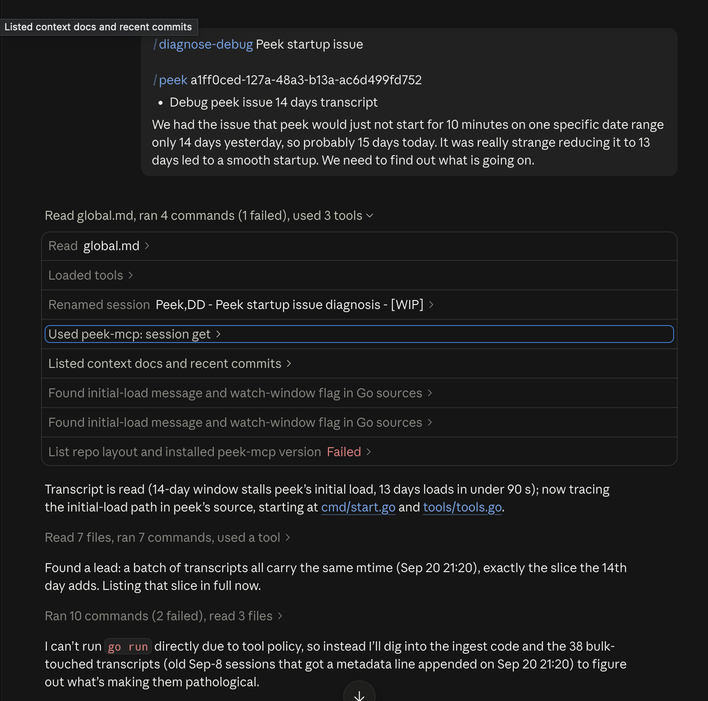

- **Status**: A status call returns bounded counters for a monitoring loop, cheap enough to poll.
- **Cost**: ccusage figures per session sit beside the window that is left.

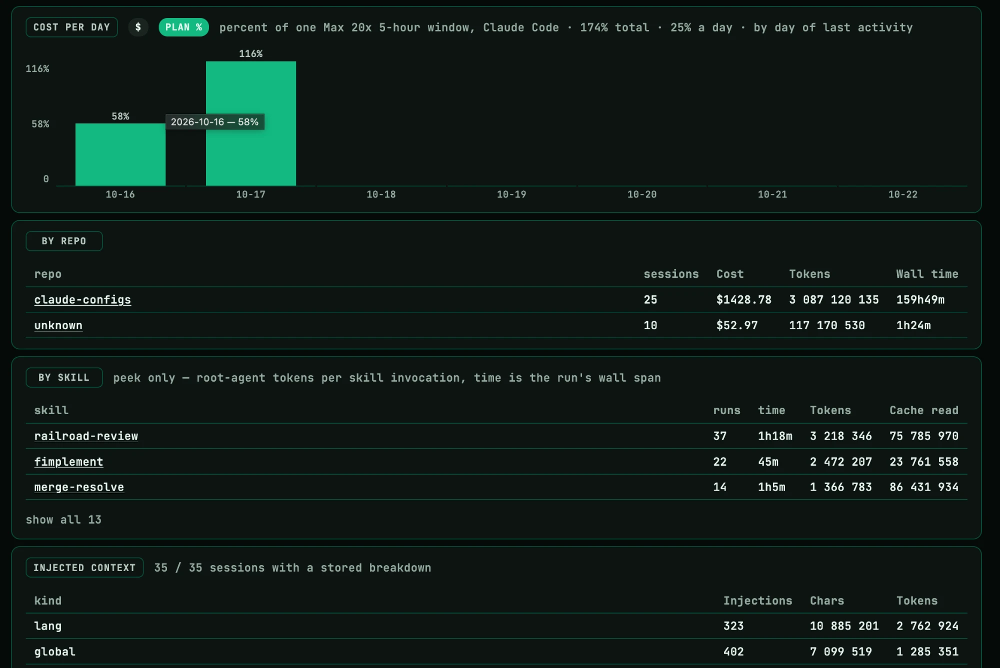
- **Estimate**: A skill's run is priced before it starts: cells, dollars, tokens, wall-clock and window fit.

Window overruns are eliminated for everything the estimate covers, which is what let a railroad-review start at 83% of a window and land at 99%, on purpose.

[smine.info/configserver.html](https://smine.info/configserver.html)

## Memory Management

Do you know what Claude currently loads into context from MEMORY.md on your machine, and whether any of it is still true or necessary?

Memory, and by extension context, goes stale and turns into subtle, hard-to-trace injections; it leads to half-solutions or rots into problems. A durable fix has to get out of memory and into a real pipeline. Consciously, or now with Smining, the nightly retrospective the whole thing is named after:

- **Mine**: Every idle session's transcript becomes one typed record, checked by Go.
- **Memory**: An auto-memory dir is drained into context docs, where it is linted and read-gated.
- **Problems**: Records are synthesized into problems, each into a skill or routine change, or an Icebox row when nothing solves it.
- **Rules**: Red rules become gates, denials become allow rules, context signals become entries, and your own voice becomes the style profile.
- **Proposals**: Each change is one commit that picks alone onto main, gets a verdict, and waits on a page where you say yes or no.

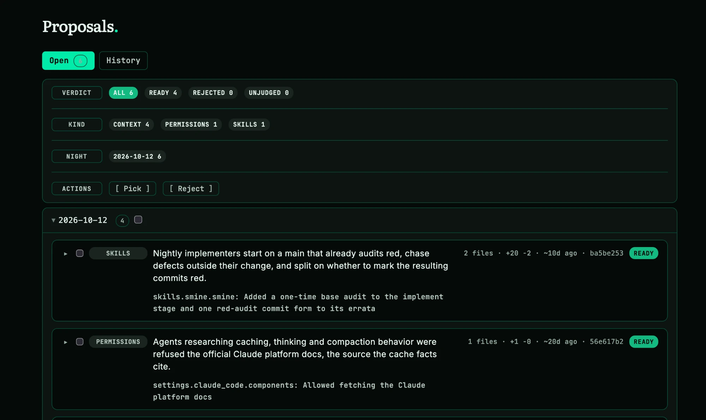

Second occurrences are eliminated for everything the pipeline reaches, skills, context, permissions, routines, which is where every "mined later" above ends.

[smine.info/skill-map.html](https://smine.info/skill-map.html)

## Worktree Sprawl

Ten worktrees on one repo ask two things of you all day: will it merge, and is it merged? Every git client I was used to broke intermittently (JetBrains caching...) or lacked the features; agentwt, a Rust tool on gix, answers exactly those two questions and nothing else:

- **Status**: Every worktree's branch, its base, what is unlanded and whether it merges clean are shown in one call.

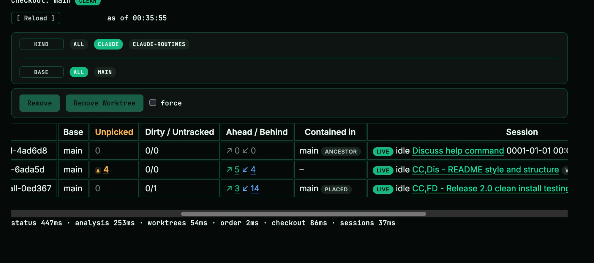

- **Merge order**: The branches are ordered so that they land without a conflict.
- **Cherry-pick and cleanup**: A change is picked alone onto main, and a worktree is removed only when nothing unlanded remains.

Guessing is eliminated for both questions on every worktree it tracks, which is what makes thirty parallel sessions a list.

[smine.info/rust-binary.html](https://smine.info/rust-binary.html) · [smine.info/heartbeat.html#merge-strategy](https://smine.info/heartbeat.html#merge-strategy)

## Steal My Smine

smine is mine by design, and the point is that it becomes yours, partially or completely:

- **Components**: There are sixteen, each a settings fragment, a hook, daemon or standalone binary, or a file tree, and what each requires and what degrades without it is shown before anything installs.
- **Presets**: Minimal (config server and skills), Full, or à la carte, with every step shown before it runs.
- **Skills**: `make skill-bundle` writes every skill that needs no smine program as a standalone bundle with its index.
- **Settings**: Each component is one settings fragment, the gate's allow list among them, readable on its own.
- **Context**: The context is markdown, linted, and needs nothing else.

Nothing here needs more than it declares.

### Install

macOS (Apple silicon; Intel: `amd64` for `arm64`):

```bash
curl -fsSLO https://github.com/kevinhorst/smine/releases/download/v2.0.5/smine-2.0.5-darwin-arm64.tar.gz
tar xzf smine-2.0.5-darwin-arm64.tar.gz
xattr -dr com.apple.quarantine smine
smine/bin/installer
```

Windows (PowerShell):

```powershell
Invoke-WebRequest https://github.com/kevinhorst/smine/releases/latest/download/smine-setup.exe -OutFile smine-setup.exe
Unblock-File smine-setup.exe
.\smine-setup.exe
```

From source (development):

```bash
git clone https://github.com/kevinhorst/smine.git && cd smine && ./install.sh
```

No Go or Rust needed for the release archives; the binaries are unsigned, hence the quarantine and unblock steps. Ports, profiles and unattended installs: [smine.info/install.html](https://smine.info/install.html).

## Caveats

Frontier is expensive, automation breeds automation, and the token bill follows.

## Credits

Thanks to Microsoft Research for Z3, and to my formal systems professor, the late Prof. Dr. rer. nat. habil. Steffen Hölldobler, for his work in computational logic and automated reasoning.

## Layout

| Path | Contents |
| :--- | :--- |
| `skills/<group>/<leaf>/` | one skill: `<leaf>.cue` is the model, `payloads/` the templates — [the skills directory](https://smine.info/skills.html) |
| `context/` | the agent context: `actions/`, `rules/`, `facts/`, the `AGENTS.md` template |
| `acdsl/` | the machine-verified rule corpus and its fixtures |
| `settings/claude_code/` | the settings template, one fragment per component; `gate.json` is the allow list |
| `cmd/`, `internal/` | the Go hook binaries and tools, the Rust crates `heartbeat` and `agentwt` |
| `routines/`, `evals/`, `sessions/` | scheduled jobs, eval records, mined session records |
| `docs/` | the docs as plain HTML, hosted at [smine.info](https://smine.info) and readable from disk — [config server](https://smine.info/configserver.html) · [skill map](https://smine.info/skill-map.html) · [Context Linting](https://smine.info/acdsl.html) · [merge strategy](https://smine.info/heartbeat.html#merge-strategy) |

## License

[PolyForm Noncommercial 1.0.0](LICENSE): free for noncommercial use; commercial use requires a commercial license — skill licenses are sold at [agensi.io](https://agensi.io).
