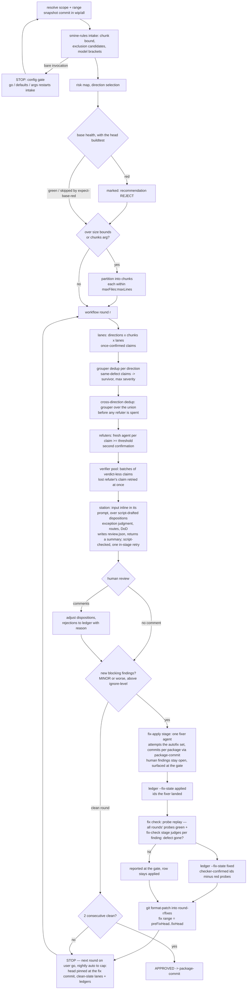

# railroad-review — Design Notes

SKILL.md is the protocol; this file is its documentation — the rationale extracted from the entries' former Why bullets
(v11.1 → v12 register rework). Keyed by entry id; NIGHTLY ids carry their pre-v12 MODES id. Never injected into any agent.

Three notes' constraint content was promoted into protocol text before extraction (dispatcher-only manifests,
worker-prompt return-contract scope, severity-definition twin discipline); their rationale remains here.

## Dependencies

The deploy fills each install-scoped variable from the environment, the install record's `skills.variables` row or
the provider implementing its interface (`skills/interfaces.cue`). An unset required variable skips the skill and the
deploy log names it.

| Variable | Interface | Needed | Without it |
|---|---|---|---|
| `SKILL_RAILROADREVIEW_BASE` | `base@1` | required | skill not deployed |
| `SKILL_RAILROADREVIEW_BUILD` | `build@1` | required, repo-scoped — the build command the build-test and the probe replay run | invocation aborts |
| `SKILL_RAILROADREVIEW_BUILDTEST` | `buildtest@1` | required | skill not deployed |
| `SKILL_RAILROADREVIEW_CLEANUP` | `cleanup@1` | required | skill not deployed |
| `SKILL_RAILROADREVIEW_ENTRIES` | `entries@1` | required | skill not deployed |
| `SKILL_RAILROADREVIEW_INTAKE` | `intake@1` | required | skill not deployed |
| `SKILL_RAILROADREVIEW_LANES` | `lanes@1` | required | skill not deployed |
| `SKILL_RAILROADREVIEW_LEDGER` | `ledger@1` | required | skill not deployed |
| `SKILL_RAILROADREVIEW_LINT` | `lint@1` | optional, repo-scoped — the lint program the probe replay runs | `--acdsl` param dropped |
| `SKILL_RAILROADREVIEW_PAIRS` | `pairs@1` | required | skill not deployed |
| `SKILL_RAILROADREVIEW_PRESENT` | `present@1` | required | skill not deployed |
| `SKILL_RAILROADREVIEW_PROBE_REPLAY` | `probe-replay@1` | required | skill not deployed |
| `SKILL_RAILROADREVIEW_PROVISION` | `provision@1` | required | skill not deployed |
| `SKILL_RAILROADREVIEW_PRUNE` | `prune@1` | required | skill not deployed |
| `SKILL_RAILROADREVIEW_RESET_ROUND` | `reset-round@1` | required | skill not deployed |
| `SKILL_RAILROADREVIEW_SNAPSHOT` | `snapshot@1` | required | skill not deployed |
| `SKILL_RAILROADREVIEW_TEST` | `test@1` | required, repo-scoped — the test command the build-test runs | invocation aborts |
| `SKILL_RAILROADREVIEW_TITLE_SET` | `title-set@1` | required | skill not deployed |

Build, test and lint commands are repo-scoped skill variables set per repo, or as the default, on the skill page's
Environment section. Build and test are required: without them the refuters can only judge by reading, so an
invocation in a repo with neither a value nor a default aborts. Lint is optional.

Context dir: the tool resolves it — `context/` holding `context.json`, else the deployed dir holding `context.json`. With
neither, `lanes` exits 2 and the review stops with that line (Lanes refused) — no doctrine-less review.

Hook components the lanes lean on: context (skill-context injection and the read-gate), gate (the Skill-first order),
heartbeat with gate (the enforce anchors and checks). None of them is required to run; without them the review runs
unenforced and lanes get no injected doctrine.

## Design notes

### SKILL-RAILROADREVIEW-DIR-006

a deliberate user-directed coverage widening, distinct from the hook-enforced coverage contract ([Coverage check](#skill-railroadreview-round-005a)) that gates each lane's artifact write on its assigned list being fully read.

### SKILL-RAILROADREVIEW-MODES-003a

the workflow's base directory is stated at skill load; the stage files stay decomposed, but the interactive route packs
them into one `round.js` invocation per round (child workflows, in-memory handoff) — the g2 run (2026-09-16) showed 6
separate Workflow invocations cost a 2-3 minute dispatcher turnaround each, rivaling the stage work itself, and every
dispatcher-side jq handoff was a paraphrase opportunity. Since v21 cleanup is no workflow at all: `smine-rules cleanup`
runs from the dispatcher after the fix pipeline, outside the round barrier. The stage args shrank with it — `testPairs`,
`manifestDir`, `diffFiles` and `stationInputPath` are gone because the lane plan, the manifests and the station input no
longer travel through the dispatcher.

### SKILL-RAILROADREVIEW-MODES-003c

artifactsDir sits outside every worktree, so agents read both by absolute path and no content travels by value. Since
v21.1 it lives under `~/.cache/claude-routine/artifacts/railroad-<runNs>/artifacts` (or the invocation's handshake dir):
`~/.cache/claude-routine/artifacts` is a non-repository additional directory admitted by the harness and the gate, and the
per-run parent also holds `wt/` — the disposable base-health and explicit-mode worker worktrees `smine-rules cleanup`
removes. The trailing `/artifacts` keeps `dirname(artifactsDir)` per run, the contract skilleval's `<worktree>-out`
handshake shares.

### SKILL-RAILROADREVIEW-MODES-003d

coverage becomes measurement by the enforcing hook instead of a lane attestation; a lane-written manifest would re-open the
padding hole. Until v20 the dispatcher hand-wrote the manifests into a machine-global manifest store under
`~/.claude` — the 2026-09-27 run needed a helper agent for 32 of them, and headless writes there were denied as sensitive-file
edits, so the read-gate never enforced anything. Since v21 `smine-rules lanes` computes the lane set (relevance,
coverage, partners, walks) and writes each manifest next to its artifact as `<artifact>.lane-manifest.json`; the hook
derives the manifest from the artifact path — no store to enumerate, no namespace directory — and denies Write/Edit of any
`*.lane-manifest.json`, which closes the padding hole on the tool path.

### SKILL-RAILROADREVIEW-NIGHTLY-000..012 (deleted at v20)

*Deleted at v20 — headless `claude -p` runs the Workflow and Skill tools, so the nightly dispatcher runs the same workflow route; the Agent-tool fan-out (warm-up lane, batched dispatch, brief files, dispatch ledger, in-flight cap, detached branch step, jq station input) existed only because headless once lacked the Workflow tool. What stays nightly-only: no per-round go (NIGHTLY-001a) and the API-error wait before a failed round's re-dispatch.*

### SKILL-RAILROADREVIEW-MODES-016c

redispatching every file to every direction every round buys no recall — code-style converges in one clean pass while security keeps looking; the reset rules keep changed or dirty files in scope.

### SKILL-RAILROADREVIEW-NIGHTLY-009a (was MODES-015a)

*Deleted at v18 — subsumed by EXEC-003d, which makes paths-only the rule on every route, not only the nightly one; the
rationale below is the historical note.*

applied to each prompt's return contract. A round funnels dozens of worker results through the dispatcher; inline findings overflow even a 1M-token context before the station lands.

### SKILL-RAILROADREVIEW-NIGHTLY-003 / NIGHTLY-003b (deleted at v16)

historical: the nightly-only apply ceiling existed because a major/blocker fix mutates the reviewed range enough to
diverge later rounds and break comparability across eval arms, while nit/minor fixes are indiscussable and safe to land.
At v16 the route split died — `apply-level` is one knob with one meaning on every launcher (Fixes section owns the
doctrine), and comparability is the eval contract's concern via its own `apply-level` value, not a route split. Since v23
the knob is `autofix-level`.

### SKILL-RAILROADREVIEW-NIGHTLY-007 (was MODES-012)

keeps concurrent or interactive `claude-review/*` branches in the same repo untouched and attributable.

### SKILL-RAILROADREVIEW-MODES-018

no arg, no threshold — a considerable drop in new confirmed findings is weak, unvalidated evidence about the residue;
since v22.0.2 the suggestion raises the lane model to `opus` (fable runs no subagent), and everything beyond "fewer
findings" is conjecture. The switch stays a human decision because the evidence is thin.

### SKILL-RAILROADREVIEW-ROUND-002

the checkout is the pin, in either direction: a harness worktree forks from the dispatcher's tip at spawn, so one commit
landing on the branch after the pin used to abort every lane of the round (2026-10-02 run, 8 of 8 lanes). Since v22.3
every isolated worker renames its branch first, then checks out `headCommit` when HEAD differs, so no harness branch is
left orphaned; the checkout also anchors the otherwise unreferenced snapshot.

### SKILL-RAILROADREVIEW-ROUND-006

max group severity lets any lane's higher vote still reach the `refute-level` threshold; a wrong merge silently drops a finding, a missed merge only costs one duplicate refutation. Since v17 the survivor takes the max-severity member's cells with the severity, so the id, severity and cells stay one consistent claim.

### SKILL-RAILROADREVIEW-PROC-007b

the lane-side uses of the risk map were deleted at v18: the skim sentence ("read low-tier files only for scope creep")
contradicted the manifest gate, which already forces every assigned file read in full, and the high-tier extra clean
round was bookkeeping nobody honored. The data point: golden v9 joined to a run's risk map — low tier 66 findings, 7 MAJOR,
0 BLOCKER, the 7 real user-facing template bugs a per-file guess had told lanes to skim. The map itself stays, written
every round, with one consumer that has teeth: direction selection and the security add when no `directions` arg is given.

v21.2 dropped the print duty ("PRINT the map"): `risk-map.json` is the only consumer's input, while a chat copy was
read by nobody.

### SKILL-RAILROADREVIEW-EXEC-003d

no agent produces or ingests one huge message: the output-limit incident lost a whole lane's findings to a truncated
return, and the grouper, refuter and station prompts each pasted every claim body. Refs carry exactly what the scripts
compute on (id, cells, fix, severity, paths) and nothing more; the `artifact_id` survives the `-r{r}` suffix and the SEV
re-mint so the body is always one jq call away. This generalizes the former nightly-only rule (NIGHTLY-009a) to every
route.

### SKILL-RAILROADREVIEW-WALK-001

the output format forces the attention: a lane that must write one answer per file × group cannot skim the files it
"feels done" with, and cannot stop before the last group. The checklist lives in the lane manifest because the hook already
looks there — one file per lane, one lookup, no second store.

### SKILL-RAILROADREVIEW-WALK-003 (deleted at v21)

*Deleted at v21 — `smine-rules lanes` builds the rule walks while writing the manifests; the rationale below still holds
for that function.*

the checklist is built by a typed, tested Go function beside the parser it uses (`rules walk`, sibling of `rules entries`)
rather than jq, because the grouping (family split, guide join, enforcement filter) is a policy computation that has to be
debuggable and reproducible in a deployed repo; lint- and gate-enforced entries are dropped because the tools own them
(the `[review]`/`[lint]` split). Families are the grouping unit because they are how the entries are already written.

### SKILL-RAILROADREVIEW-WALK-006

the hook is the only place that can hold the lane to its checklist without the lane knowing a budget: the same gate that
denies the artifact write until every file is read denies the completion mark until every pair is answered, and it fails
open on every malformed input so a manifest without `walk` behaves exactly as before.

### SKILL-RAILROADREVIEW-WALK-007

steps times context is the cost of a lane: one final dump loses everything when the lane dies at the output cap (the
observed incident), and a Write re-sends the whole file each time; Edit appends send only the delta and leave a
continuation lane a complete record to resume from. The station gets the same rule because its review.json was the
other one-big-Write in the pipeline.

### SKILL-RAILROADREVIEW-WALK-009

lanes stay budget-blind by design (never a budget word in a worker prompt); continuation therefore lives in lanes.js,
keyed on the two signals the workflow can see — a null return (lost agent) and a returned `walk_open > 0` — and stops
after two consecutive losses or a run that closed nothing, mirroring the one-retry doctrine elsewhere in the skill.

### SKILL-RAILROADREVIEW-WALK-010

item ids exist before any lane runs because the dispatcher writes them, so a finding on a spec requirement cites
`correctness-7` rather than a prose quote; this is the severity vector's citation target — an absent required behavior
(`effect: incorrect`) needs a line to cite, and the walk item is that line. An unanswered item is never a finding because the answer step is where the
evidence is gathered.

### SKILL-RAILROADREVIEW-ROUND-033

severity is recomputed from the cells at dedup entry because the lane's own table lookup is a second implementation of the same function — where the two disagree the data wins, the id's SEV token is re-minted so ids stay truthful, and the correction is visible in the funnel instead of silently overwritten. The recompute runs over the in-memory lane returns (the Workflow runtime has no filesystem), so every claim object reaching dedup.js and verify.js must carry `effect`, `exposure` and `fix`.

### SKILL-RAILROADREVIEW-STATION-004c

the tail exit (v17–v24) parked immaterial findings outside every ledger, so lanes re-found and verifiers re-confirmed them each round; since v25 every second-confirmed finding is ledgered and the rows at or below `ignore-level` are `ignored` — suppressed at source by the known block, hidden at the gate, never fixed; blocking is severity-fixed (NIT and INFO never) rather than a per-finding flag.

### SKILL-RAILROADREVIEW-ROUND-007

refutation runs after both dedup passes so no refuter is ever spent on a duplicate — refuters are the expensive agents
(full context injection on the lane model). Since v16 refutation and the verification pool share one stage barrier
(verify.js): the pool's bulk input — below-`refute-level` claims — is known at dedup output and refute-independent, so
the old refute→verify serialization was pure wall-clock cost; only lost-refuter retries wait on refutation results.
Since v17 refuters attack the cells as claims and may return their own; the script takes the lower of the two table
rows and never a higher one, because the observed drift across 11 eval runs was upward (118 of 132 misclassifications) —
a refuter is a downward force by construction, so TIEBREAK DOWNWARD became mechanical.

### SKILL-RAILROADREVIEW-ROUND-022a

dedup-before-refute — a cross-direction duplicate that reached refutation would burn a full refuter for a verdict the survivor already gets.

### SKILL-RAILROADREVIEW-ROUND-023

each such agent carries the full context injection on the lane model, so the cap mirrors the environment's real subagent limit — never an intake arg; the 16 is the runtime's own ceiling, not a tuning choice.

### SKILL-RAILROADREVIEW-ROUND-024a

every API call re-reads the agent's whole context, so per-agent call count is the dominant cost lever (measured: workers averaged 21 calls each on a 6-round run).

### SKILL-RAILROADREVIEW-ROUND-024b

a mid-run tool load invalidates the prompt cache from the tools level, forcing a full-context rebuild at the accumulated size — expensive, not a hard failure.

### SKILL-RAILROADREVIEW-PROBE-005

every confirmed claim stays mechanically recheckable.

### SKILL-RAILROADREVIEW-EXEC-003b

a multi-round railroad accumulates the dispatcher's context on every call; keeping it to coordination and user-facing input/output is what keeps a long review affordable.

### SKILL-RAILROADREVIEW-EXEC-003c

a dispatcher that materializes and re-reads per-chunk hunk files carries the whole reviewed diff through its own window; paths and line counts answer every dispatcher question at a fraction of the tokens.

### SKILL-RAILROADREVIEW-STATION-005b

an ad-hoc severity-filtered fix plan silently drops confirmed low-severity findings — neither fixed nor approved. At v16
`apply-level` became the ONE sanctioned severity filter, identical on every route. v23 renamed it `autofix-level`
because the level names who fixes: at or below it the fix workflow fixes, above it a human does — the old name read as
"apply everything up to" and hid that. The default moved from `blocker` to `minor`. The route still decides too: a
finding the station routes `human` never enters the fix set, whatever its severity. `smine-rules ledger` computes the set
from level and route in one place; until v23 it split by severity alone and the dispatcher picked the `auto-fix` ids out
by hand, so a set of only human-routed entries fired the fix step with nothing to fix. Everything outside the set stays
`open` in the known ledger and surfaces at the gate — never silently dropped.

### SKILL-RAILROADREVIEW-MODES-001 (v16 no-hold rewrite)

the old fix-plan HOLD and the per-round approval pause made in-run fixing impossible unattended, which defeated the g2
golden line's whole point (apply-and-re-review inside the run). The gate is a non-blocking checkpoint: comments present
are binding, silence is stated approval, and the interactive STOP moved to the round boundary — the round runs
end-to-end, a NEW round needs explicit go.

### SKILL-RAILROADREVIEW-INTAKE-002 / INTAKE-003 (v24.3 config gate)

a bare invocation used to start on defaults with nothing shown; the facts a configuration needs — diff size, what in it is generated or data, which brackets apply — existed only once lanes ran. `smine-rules intake` computes them from the numstat in one command, so the report is the offer and the reply is the decision: one pause, never a question whether to analyze first. The hard classes (generated, lockfile, vendored, binary) are the one source of PROC-005's pre-exclusion; prose and records stay the user's call because they may be the reviewed change. The gate is a chat STOP like the round gate, so EXEC-002 names both; `--gate` is the explicit marker the title state keys on, since a non-bare run prints the same report without waiting. A nightly run always carries args and never sees the gate.

### SKILL-RAILROADREVIEW-STATION-005 (v22 fix loop removed)

the fdesign/fimplement fix loop is gone: one `railroad-fixer` agent applies the auto-fix set through `fix-apply.js`, the
dispatcher never edits a file, and `human` findings stay in the known ledger for the gate.

v23 made the fixer best effort: it attempts every finding it is handed, implementing the proposed fix and, where the code
moved, the smallest change that removes the defect the claim names. Before, a finding whose proposed fix did not fit was
skipped and nothing read the skip list, so auto-fix findings stayed unfixed silently. `failed` replaces `skipped` and is
reserved for a change that cannot be made at all (a denied write, vanished code); the dispatcher relays it and those rows
stay `open`. The fix check judges the result against the claim, so a fix that differs from its proposed text is still
held to the defect.

### SKILL-RAILROADREVIEW-STATION-004c (v16 full ledger)

the above-`apply-level` filter left applied fixes without a ledger row — a probe-replay hit later had nothing to flip.
Every confirmed finding now lands in known.json. Since v21 `smine-rules ledger` computes the split (formerly a shell
script), the known-ledger append and the coverage ledger — the 2026-09-27 run kept the ledgers by hand and skipped the
coverage ledger entirely.

Until v23 a row carried `applied` and `fixed`, both written true at the ledger call, before any fixer ran: a presumed
fix made a later re-find count as an oscillation, and the golden judge read it as a fix that escaped. v23 replaces both
with one `fix_state`, written by its observer in three calls: the round ledger call appends every new row as `open`,
`--fix-state applied` runs with the ids the fixer landed, `--fix-state fixed` with the ids the fix check confirmed. A
state nobody observed cannot be written, and `fixed` without `applied` cannot exist. `--unfix` is gone; a later
probe-replay hit demotes a `fixed` row back to `applied`.

### SKILL-RAILROADREVIEW-ROUND-009e

the g2 run's sonnet-5 dispatcher hand-condensed the inline station input while assembling the prompt. The paraphrase risk
was dispatcher assembly, not the script: text the station stage builds itself is verbatim by construction. v20's cure — a
writer agent echoing the script's object into a station-input file — died at the 64k output cap after 29 minutes on a
96k-token input in the 2026-09-27 run. Since v21 the input travels inline in the script-built station prompt: input
tokens, no output cap, no copy.

### SKILL-RAILROADREVIEW-EXEC-003e (new at v21)

the 2026-09-27 run asked four LLM agents to copy data the script already held — station input, tail, the full review.json
return, lane manifests; one died after 29 minutes at the 64k output cap. The Workflow runtime has no filesystem, so every
script-computed file went through an LLM. The rule: a file is written by the program that computes it or the agent that
authors it; the `make workflow-gen` shape check bans the copy-back phrasing from the stage files.

### SKILL-RAILROADREVIEW-TPL-007 (v16 scripted salvage, v21 Go)

the 6-step prose recipe made the cleanup agent improvise per-file shell ops over dozens of worktrees — slow,
stall-prone, and unfaithful (the g2 run reported "zero residue" while two worktrees survived). v16 made the sequence a
shell script run by a cleanup agent — which still looped it one worktree per call (93 calls,
8.4 minutes in the 2026-09-27 run) and hit glob denials. Since v21 `smine-rules cleanup` (package `internal/gitwt`) is the
whole sequence, run once by the dispatcher: every worktree on the run prefix and under the explicit root is salvaged and
removed unforced, and every run branch's diff is saved before deletion. Since v22.3 the round launches' run ids select
the harness worktrees of agents that died before their rename, a worktree that fails to salvage goes to `skipped` with its
error while the rest go on, and `smine-rules reset-round` runs the same sequence for one failed round before its retry.
The fixer has no worktree of its own, so no registration step exists to forget.

### SKILL-RAILROADREVIEW-STATION-016 / STATION-017 (v23)

the two `--fix-state` calls are steps of their own because each records a different observer: Record applied takes the
fixer's `applied` return, Record fixed takes the checker's `fixed` ids minus the round's red probes. An enforce check
pins Record fixed behind both fix-check.js and `smine-rules probe-replay` since the fix-apply launch, so `fixed` can only
mean "checked and gone". A row is addressed by round and finding id because finding ids carry no round.

The scoped fix re-review (PROC-010, STATION-005d) was deleted at v23: it had no defined launch, and either launch would
have overwritten or shadowed the round's `review.json`. The next round is the review of the fixes — it pins its head at
the fix commit and gets `known.json` by path — and each round leaves one patch under `round-{r}/fixes`.

### SKILL-RAILROADREVIEW-STATION-011a

fix fallout otherwise surfaces one full round later at full round cost; a review whose fixes regress never terminates.

### SKILL-RAILROADREVIEW-STATION-011b

probes already persist recheckable ([Probe persistence](#skill-railroadreview-probe-005)); replay makes them a cumulative regression ratchet.

### SKILL-RAILROADREVIEW-STATION-011c

unplanned fix mechanism is the top fallout source.

### SKILL-RAILROADREVIEW-STATION-013

the data contract is review.json; presentation format lives in the plan-format interface, not in a second per-round artifact every station must author.

### SKILL-RAILROADREVIEW-OUT-005

severity was one holistic judgment over an unbounded feature space; across 11 eval runs 118 of 132 severity
misclassifications were upward drift (MINOR→MAJOR 47, NIT→MINOR 35, INFO→MAJOR 20, INFO→MINOR 12). Three factual cells
are questions a reviewer already answers — what breaks, who is hit, how often — and each is refutable on its own. The
cell names avoid every existing repo concept: `reach` was rejected because context entries already carry a `Reach:`
field (the repos an entry deploys to); `promise` folded into `effect: missing`. The lane prompt in `workflows/lanes.js`
renders the table and the example fixtures from the same JSON the script reads, so there is no prose twin to keep in
step. The risk map does not gate severity: it tiers files by name before any code is read, and in the 2026-09-12 eval
join 7 low-tier findings were real MAJORs (`internal/server/templates/*.html`) — a per-file guess must not cap a
per-finding fact.

v2 (18.1.0) dropped the `affected` cell after the 2026-09-24 row review: with the ratified grade edits the axis
discriminated one row pair (destroys+rare) of fourteen while every lane paid for the cell on every finding. Stakeholder
modelling is parked, not rejected — a richer affected axis is a future change once projects with more stakeholder classes
exist. `missing` folded into `incorrect` because v1's flat MAJOR was the only row ignoring exposure; `worse` split into
`degraded` (runtime, felt by users or operators) and `debt` (felt only by developers) because one grade for both
understated runtime regressions and overstated code-level ones. The exposure words became `always | often | rare |
eventually` for the same reason the effect words changed: the v1 words did not say what the cell meant.

### SKILL-RAILROADREVIEW-OUT-005b

the table is data with a gate (ACDSL-SKILL-015) rather than prose because a policy row is a decision the operator ratifies, and
a gate that proves every one of the 20 cell combinations resolves to exactly one row is what makes a row edit safe. The
fixtures replace the never-materialized `severity-rulings.json` precedent ledger of the deleted severity-check agent
(STATION-012/015): a check that could only flag turned disagreement into a human decision that accumulated; a recompute
that can act, plus fixtures that fail the gate when the table drifts, replaces it.

### SKILL-RAILROADREVIEW-PROC-011 (v19)

Correctness lanes read `_test.go` files without test-scoped judgment and flagged patterns the repo's test conventions
sanction; tests lanes could receive a test without the production code it covers because chunks split the pair. Test
classification and pairing moved into Go (`rules pairs`, `internal/reviewscope`): the workflow runtime has no filesystem,
and one computed result feeds the lane lists the read-gate checks — dispatcher prose computing it by hand would drift from
them. Since v21 `smine-rules lanes` pairs files itself; the dispatcher reads `pairs` only for direction selection. Correctness's test-only spec requirements move to tests lanes
(WALK-005 param) because a correctness lane that cannot see tests would FAIL them as missing.

### SKILL-RAILROADREVIEW-ROUND-035 (v19)

Refuters and verifiers used to get the claim ref and the direction name only — no injection, no manifest, no spec, no
rejected ledger — so second confirmation judged with less context than first confirmation. They now load the same
`lane:<direction>` slice through the same marker gate; verifier batches became single-direction so one token fits.
Groupers stay text-only: dedup compares claim text, it never judges code.

### Stacks removed (v24)

v19 to v23 detected stacked heads (`rules stack`), attributed findings to a branch below head (`introduced_in`) and kept
those findings out of the fix set. v24 removes all of it. Detection kept any unmerged local branch whose fork with head
lay above mainline and never read the review base, so an explicit bracket did not bound it; in the 2026-10-04 eval a
branch one commit below head matched every blamed commit, all 151 findings were recorded down-stack and nothing was
fixed. Which branch a review belongs to cannot be decided from the local branch layout. `smine-rules base` now resolves
the base alone — bracket, else upstream fork, else mainline fork — and every finding is fixed like any other.

### SKILL-RAILROADREVIEW-EXEC-004 (v22.3)

a background Bash call yields an empty stdout, so the heartbeat capture anchors could never see a buildtest result; the
rule that collected background tasks named a tool the harness no longer offers. Every `smine-rules` command runs in the
foreground, and a Workflow launch resumes the round through its notification. The four capture anchors exclude `|`, `;`,
`&`, a backtick and `$(`: in the 2026-10-02 run a `buildtest … | jq -n '{…}'` call let jq's literal pass as the build
result. Heartbeat parses no shell; the exclude is declared here and visible in `enforce.json`.

### SKILL-RAILROADREVIEW-SCOPE-004 (v22.3)

one head per round: branch scope had no pin step, so every worker forked from whatever the branch tip was at its spawn.
The dispatcher now resolves `headCommit` once, before `base`, `lanes` and the buildtest, and every command and prompt
of the round names it; a commit landing mid-round is reviewed by the next round. The fix range is the fix commit and
its first parent, whatever else landed since the pin.

### SKILL-RAILROADREVIEW-STATION-002 / TPL-009 (v22.3)

a round whose lanes all aborted produced a `review.json` reading APPROVE over an all-zero funnel, and its retry reused
every name while the first attempt's worktrees and branches still existed. The round script now returns a void round
without a station; `ledger --void` is the sanctioned record that satisfies the ledger-before-next-round check, and
`reset-round` salvages and removes the attempt before the retry, which keeps its names.

### SKILL-RAILROADREVIEW-TPL-008 (v22.3)

the Workflow harness hands the session's newest typed message to every agent of a launch, except for a launch from a
turn that a workflow completion notification opened. The tool-policy gate denies a launch after a typed message; the
primer, an agentless ten-second script carrying the `SMINE-PRIMER` marker, opens such a turn; heartbeat skips the turn
end behind any Workflow launch, the primer's included.

## v13 extractions

Rationale pulled out of the entries during the v13 ontology rework — see the changelog. MODES-018 lost its `escalate` arg and
thresholds — the whole idea stayed, reduced to a no-arg, evidence-free suggestion; see its note below.

### SKILL-RAILROADREVIEW-DIR-002

no findings cap anywhere is deliberate: volume is bounded by the falsifiability bar, per-direction and cross-direction dedup, and twice-confirmation — a count guidance to lanes would bias them toward inventing or suppressing findings to hit a number. Empty findings is a valid clean result.

### SKILL-RAILROADREVIEW-TPL-001

the former worked example of the falsifiability bar — an accepted concrete-trigger finding versus three rejected opinion/naming/architecture claims. Teaching material, not protocol; the bar entry (DIR-002) and the lane prompt carry the operative rule.

### SKILL-RAILROADREVIEW-MODES-017

the station is judgment-only over script-drafted dispositions; its default is the default subagent model (`opus`) at high effort, and `station:` overrides it for one run. Since v21 no agent carries a hardcoded model (the [Model assignment](#skill-railroadreview-tpl-006) table is the single source): the mechanical agents became Go commands, and the fix pipeline's one `railroad-fixer` agent works in the dispatcher's checkout. The bracket separator became `:` because a colon never occurs in a model id — a dash-joined token like `opus-medium` left model versus effort to a last-segment guess; workflow agents resolve harness aliases only, so a full id reduces to its alias.

### Model — sonnet-5 evidence (g2 eval 2026-09-16, run 1f487cd0)

the sonnet-5 dispatcher mislabeled the scoped fix re-review as "round two" (user-corrected), hand-condensed the station
input (the ROUND-009e trigger), and needed repeated protocol correction. The sonnet-5 fimplement loop shipped an
inadequate fix for the round's policy-gate BLOCKER (confirmed bypassable both before and after the fix) and introduced
two new defects (install.env root resolution, GitChangedFiles coverage gap) that the re-review caught. Dispatcher and
station are recorded tested-unviable on sonnet-5; lanes at sonnet-medium remained under evaluation until the run below.

### Model — sonnet-5 lanes (golden test 2026-10-06, run evals/railroad-review/2026-10-06-1f725c)

the first test against the g2 v1 golden (352 entries minted from five opus-lane runs) ran `lanes: 1[sonnet:medium]`
over two rounds with `autofix-level: minor`; the harness alias `sonnet` resolved to `claude-sonnet-5`, the station ran
opus. Recall 13.6%: 48 of 352 matched through 44 of 61 candidates, 1 of 8 BLOCKERs (a fix escape), 7 of 41 MAJORs, 11
false positives, 29 severity mismatches, 10 defects still present behind an applied fix. Review score 0 — the 36 handled
entries saved 597 reviewer minutes and the false positives cost 603. The run also spent more usage window than opus
lanes: 126% of a Team Premium window against 117% for `2[opus:medium]` over two rounds and 79% for one round, because
cache reads dominate a review worker's bill and the weight table prices a sonnet read like an opus read, while the
finding-proportional stages (refuters, verifiers, 41 fixers, fix checks) do not get cheaper with the lane model. The
sonnet class is therefore out of this skill in every role; the Model section records opus as the floor. Full numbers in
the run's `interpretation.md` and `eval.json`.

### SKILL-RAILROADREVIEW-ROUND-011a

the verifier pool is the twice-confirmed invariant's completeness backstop, never a device to reduce refuter load — every survivor is second-confirmed exactly once regardless.

### SKILL-RAILROADREVIEW-ROUND-016

build-test is distinct from base health ([Base health](#skill-railroadreview-proc-009)): base runs once per review at the fork point, build-test once per round at the review head. Since v21 both are `smine-rules buildtest` runs, never agents. Since v22.3 both run in the foreground, as two Bash calls in one message with the 600000 ms timeout: a background call answers with an empty stdout and a task id, so the heartbeat anchor never captured `build`/`tests` and the round launch's provenance checks could never pass; the tool that collected background tasks no longer exists. Since v22.4 `expect-base-red` and `expect-head-red` skip their check instead of tolerating its result: the dispatcher runs the same anchored `smine-rules buildtest` call with `--skip`, which provisions nothing and answers both steps `skipped: …`. The command form, the heartbeat anchors and the provenance checks stay the same either way, a skipped step never stops the round or caps the recommendation, and a review of a tree that is red for known reasons — or a smoke — no longer pays for two full builds (8 of 11 minutes in the 2026-10-02 smoke). Before v22.4 `expect-base-red` still ran the base build and only tolerated a red result. Since v24 a red base no longer stops the review: it travels to the station as `base_health`, `smine-rules present` shows it beside head health, and it forces REJECT (a station defect otherwise) — a stop lost the whole review, a marked result loses nothing.

### SKILL-RAILROADREVIEW-ROUND-021

branch names abbreviate the lane token to `l<i>` while artifact filenames spell `lane<n>` — both derive from the script, so the two forms are intentional, not a naming drift. Since v21 cleanup is `smine-rules cleanup` run by the dispatcher — see TPL-007.

### SKILL-RAILROADREVIEW-EXEC-003a

a mid-railroad tool load invalidates the dispatcher's prompt cache from the tools level, so every tool the railroad needs is loaded before round 1.

## Flow diagram

Station-protocol flow (maintainer documentation, moved out of the agent-facing body):

